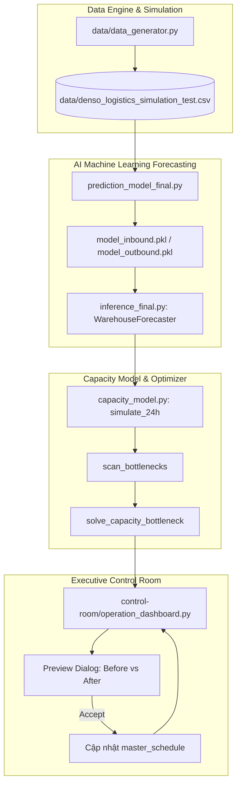

# DENSO Factory Logistics - Đội D2 (Babi)

Hệ thống Giám sát & Điều độ Chủ động Dòng chảy Kho 3 Tầng Thông minh (Closed-Loop Rolling Control & Predictive Heijunka Dispatching) phục vụ cuộc thi DENSO Factory Hackathons.

---

## 1. Tổng Quan Giải Pháp

Hệ thống giải quyết bài toán điều độ logistics nội bộ nhà máy sản xuất linh kiện ô tô DENSO bằng cách kết hợp 3 trụ cột:
- Dự báo nhu cầu AI đa khung giờ (1h, 3h, 12h) bằng `HistGradientBoostingRegressor` kết hợp cơ chế bù sai số thích ứng thời gian thực (Online Adaptive Bias).
- Mô phỏng động lực học chuỗi logistics kho 3 tầng theo nguyên lý Kéo (Pull Flow TPS) với áp lực ngược (Backpressure) và phản hồi tồn kho ERP.
- Bộ giải Heijunka tự động tìm kiếm phương án san tải, điều chuyển nhân sự cross-dock, đổi ca dọc, tăng ca OT và điều phối đội xe tự hành AMR với các đại lượng pallet nguyên chặt chẽ.
- Trung tâm điều hành Control Room thời gian thực trên nền Streamlit với cơ chế xem trước (Preview Modal) Before vs After và áp dụng trực tiếp vào vận hành.

---

## 2. Kiến Trúc Hệ Thống



---

## 3. Cấu Trúc Thư Mục

```
DENSO_Factory_Hackathons-D2-babi/
|
|-- README.md                              # Tài liệu tổng quan hệ thống (File này)
|-- DATA_README.md                         # Đặc tả chi tiết tập dữ liệu và script mô phỏng
|-- requirements.txt                       # Danh mục thư viện phụ thuộc tối giản
|
|-- data/                                  # Dữ liệu mô phỏng và script phát sinh
|   |-- data_generator.py                  # Script sinh dữ liệu mô phỏng chuỗi logistics
|   |-- denso_logistics_simulation_test.csv# Tập dữ liệu chuẩn 15 tháng (10.944 giờ)
|   |-- table_1_workload_inbound.csv       # Bảng kết quả Inbound tập test 2027
|   |-- table_2_workload_outbound.csv      # Bảng kết quả Outbound tập test 2027
|   |-- table_3_storage_inbound.csv        # Bảng mô phỏng tồn kho Inbound tập test 2027
|   |-- table_4_storage_buffer.csv         # Bảng mô phỏng tồn kho Buffer tập test 2027
|   `-- table_5_storage_outbound.csv       # Bảng mô phỏng tồn kho Outbound tập test 2027
|
|-- control-room/                          # Module Trung tâm điều hành thời gian thực
|   |-- operation_dashboard.py             # Dashboard Streamlit của Control Room
|   `-- README.md                          # Hướng dẫn vận hành và đặc tả giao diện

|
|-- prediction-capacity-mode/              # Module AI Dự báo và Tối ưu điều độ
|   |-- prediction_model_final.py          # Huấn luyện mô hình HistGradientBoostingRegressor
|   |-- inference_final.py                 # Engine suy luận thời gian thực và Adaptive Bias
|   |-- capacity_model.py                  # Mô phỏng dòng chảy và bộ giải Heijunka tối ưu
|   |-- app.py                             # Giao diện kiểm thử độc lập
|   |-- model_inbound.pkl                  # Model artifact dự báo Inbound
|   |-- model_outbound.pkl                 # Model artifact dự báo Outbound
|   |-- model_features.pkl                 # Danh mục feature đầu vào
|   `-- README.md                          # Tài liệu kỹ thuật module Prediction & Capacity

|
`-- factory-simulation/                    # Module Mô phỏng số hóa nhà máy (Digital Twin)
    `-- README.md                          # Mô tả tóm tắt module đang phát triển
```

---

## 4. Định Mức Vận Hành DENSO

| Khu Vực / Thiết Bị | Định Mức Thiết Kế | Ngưỡng Cảnh Báo (80%) | Trần Sức Chứa (100%) | Đơn Vị |
| :--- | :---: | :---: | :---: | :---: |
| Sàn Dỡ Hàng Inbound | 15.0 pal/người/h | 160 pal | 200 pal | Pallets |
| Kho Đệm Kitting Buffer | Đội xe tối đa 8 AMR | 400 khay | 500 khay | Khay / Thùng |
| Sàn Xuất Hàng Outbound | 15.0 pal/người/h | 240 pal | 300 pal | Pallets |
| Năng Lực Kéo Xe AMR | 14.0 pal/xe/h | - | - | Pallets / xe / giờ |

---

## 5. Hướng Dẫn Cài Đặt Và Khởi Chạy

### Yêu cầu môi trường:
- Python >= 3.10
- Hệ điều hành: Windows, Linux hoặc macOS

### Cài đặt thư viện:
```bash
pip install -r requirements.txt
```

### 1. Khởi chạy Control Room Dashboard (Module chính):
```bash
streamlit run control-room/operation_dashboard.py
```
Ứng dụng sẽ mở tại địa chỉ mặc định: `http://localhost:8501`.

### 2. Khởi chạy Dashboard kiểm thử AI & Capacity:
```bash
streamlit run prediction-capacity-mode/app.py
```

### 3. Huấn luyện lại mô hình AI:
```bash
python prediction-capacity-mode/prediction_model_final.py
```

### 4. Sinh lại dữ liệu mô phỏng:
```bash
python data/data_generator.py
```


---

## 6. Kịch Bản Kiểm Thử Demo (Tập Test 2027)

Người dùng có thể kiểm thử các tình huống vận hành điển hình trên thanh điều khiển Control Room:
- Kịch bản 1 (Volume Spike +60%): 05/01/2027 08:00, khung dự báo 3h hoặc 12h. Nhu cầu tăng đột biến; hệ thống đề xuất làm thêm giờ OT, bổ sung xe AMR và kéo sớm Heijunka 13 pallets để triệt tiêu điểm nghẽn.
- Kịch bản 2 (Zone Imbalance): 18/01/2027 10:00. Inbound quá tải trong khi Outbound thấp điểm; hệ thống kích hoạt điều chuyển công nhân Cross-dock từ Outbound sang Inbound.
- Kịch bản 3 (AMR Breakdown): 10/03/2027 09:00. Hỏng 6/8 xe AMR; hệ thống đề xuất điều động nhân sự hỗ trợ xả kho đệm Buffer.
