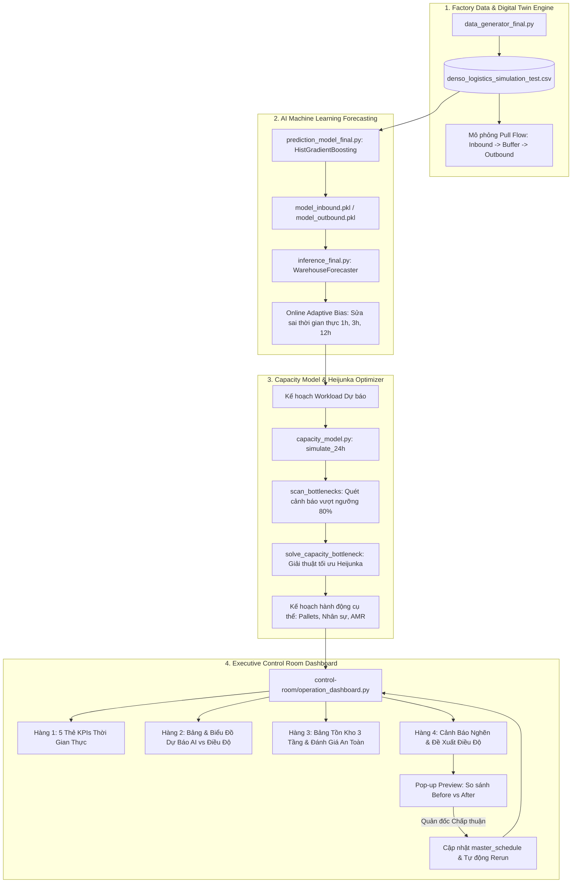

# 🏭 DENSO Factory Logistics Hackathon - Đội D2 (Babi)

> **Hệ thống Giám sát & Điều độ Chủ động Dòng chảy Kho 3 Tầng Thông Minh (Closed-Loop Rolling Control & Predictive Heijunka Dispatching)**

Dự án tham gia cuộc thi **DENSO Factory Hackathons** do Đội D2 (Babi) phát triển, giải quyết bài toán cốt lõi trong chuỗi logistics nội bộ nhà máy sản xuất linh kiện ô tô DENSO: **Dự báo nhu cầu chính xác, phát hiện sớm nguy cơ nghẽn kho và tự động đề xuất phương án điều độ san tải Heijunka tối ưu nguồn lực con người & thiết bị tự hành AMR.**

---

## 📑 Mục Lục
1. [Tổng Quan Giải Pháp](#-1-tổng-quan-giải-pháp)
2. [Kiến Trúc Toàn Diện Hệ Thống](#-2-kiến-trúc-toàn-diện-hệ-thống)
3. [Cấu Trúc Thư Mục Dự Án](#-3-cấu-trúc-thư-mục-dự-án)
4. [Các Tính Năng Trọng Yếu](#-4-các-tính-năng-trọng-yếu)
5. [Quy Chuẩn Định Mức Vận Hành DENSO](#-5-quy-chuẩn-định-mức-vận-hành-denso)
6. [Hướng Dẫn Cài Đặt & Khởi Chạy](#-6-hướng-dẫn-cài-đặt--khởi-chạy)
7. [Kịch Bản Trình Diễn Demo](#-7-kịch-bản-trình-diễn-demo)

---

## 🌟 1. Tổng Quan Giải Pháp

Trong môi trường sản xuất hiện đại, sự biến động khó lường của đơn hàng xuất nhập khẩu thường dẫn tới hai rủi ro nghiêm trọng:
- **Tắc nghẽn cục bộ (Bottleneck):** Sàn dỡ hàng Inbound hoặc kho đệm Kitting Buffer bị quá tải, gây tràn sàn và đình trệ toàn bộ dây chuyền lắp ráp.
- **Lãng phí nguồn lực (Muda):** Bố trí dư thừa nhân công hoặc xe tự hành AMR trong các khung giờ thấp điểm.

Giải pháp của Đội D2 mang lại một **vòng lặp điều hành khép kín (Closed-Loop Control)** kết hợp 3 trụ cột:
1. **Dự báo AI đa khung giờ (1h, 3h, 12h):** Ứng dụng `HistGradientBoostingRegressor` kết hợp cơ chế tự bù sai số thời gian thực (**Online Adaptive Bias**) giúp AI nhận diện tức thời các đợt tăng vọt nhu cầu (*Volume Spike +60%*) mà không bị trễ pha.
2. **Mô phỏng động học kho 3 tầng:** Mô phỏng dòng chảy hàng hóa theo nguyên lý Kéo (Pull Flow TPS) với áp lực ngược (Backpressure) và phản hồi tồn kho ERP.
3. **Bộ giải điều độ tự động (Heijunka Capacity Engine):** Tự động tìm kiếm phương án tối ưu san tải, điều chuyển ngang công nhân cross-dock, đổi ca dọc, làm thêm giờ OT và điều phối xe AMR.
4. **Trung tâm điều hành thời gian thực (Control Room Dashboard):** Giao diện Streamlit chuyên nghiệp, trực quan hóa Before vs After, hỗ trợ xem trước (Preview Modal) và áp dụng trực tiếp kịch bản vào vận hành.

---

## 🏗️ 2. Kiến Trúc Toàn Diện Hệ Thống



---

## 📂 3. Cấu Trúc Thư Mục Dự Án

```
DENSO_Factory_Hackathons-D2-babi/
│
├── README.md                              # Tài liệu tổng quan toàn bộ dự án (File này)
├── data_generator_final.py                # Engine sinh dữ liệu mô phỏng chuỗi logistics kho DENSO
├── denso_logistics_simulation_test.csv    # Tập dữ liệu lịch sử và mô phỏng chuẩn (10.944 giờ)
│
├── control-room/                          # MODULE TRUNG TÂM ĐIỀU HÀNH THỜI GIAN THỰC
│   ├── operation_dashboard.py             # Dashboard Streamlit chính của Control Room
│   └── README.md                          # Hướng dẫn chi tiết chức năng & giao diện Control Room
│
├── prediction-capacity-mode/              # MODULE DỰ BÁO AI & TỐI ƯU HÓA ĐIỀU ĐỘ
│   ├── prediction_model_final.py          # Huấn luyện mô hình HistGradientBoostingRegressor
│   ├── inference_final.py                 # Engine suy luận AI, Adaptive Bias & dải an toàn Upper 90%
│   ├── capacity_model.py                  # Thuật toán mô phỏng dòng chảy & giải Heijunka tối ưu
│   ├── app.py                             # Giao diện Streamlit kiểm thử độc lập cho module dự báo
│   ├── model_inbound.pkl                  # Model AI dự báo Workload Inbound
│   ├── model_outbound.pkl                 # Model AI dự báo Workload Outbound
│   ├── model_features.pkl                 # Danh sách đặc trưng đã lưu
│   ├── table_1_workload_inbound.csv       # Bảng kết quả Workload Inbound tập test 2027
│   ├── table_2_workload_outbound.csv      # Bảng kết quả Workload Outbound tập test 2027
│   ├── table_3_storage_inbound.csv        # Bảng kết quả tồn kho Inbound tập test 2027
│   ├── table_4_storage_buffer.csv         # Bảng kết quả tồn kho Buffer tập test 2027
│   ├── table_5_storage_outbound.csv       # Bảng kết quả tồn kho Outbound tập test 2027
│   └── README.md                          # Tài liệu kỹ thuật chi tiết của module Prediction & Capacity
│
└── factory-simulation/                    # MODULE MÔ PHỎNG SỐ HÓA NHÀ MÁY (DIGITAL TWIN)
    └── README.md                          # Đặc tả vật lý, động học Pull Flow & 5 kịch bản căng thẳng
```

---

## 💡 4. Các Tính Năng Trọng Yếu

### 1. Độc lập & Bóc tách sai số tự nhiên (Zero Feedback Confounding)
Hệ thống lưu vết số pallet được dời ca do can thiệp của con người (`committed_heijunka_in/out`). Khi sang giờ mới, lượng can thiệp này được bóc tách để mô hình AI chỉ học sai số dòng chảy tự nhiên, triệt tiêu hoàn toàn rủi ro bùng nổ sai số ảo.

### 2. Chuẩn hóa số nguyên rời rạc chặt chẽ (Strict Integer Logistics Units)
Toàn bộ các đại lượng điều phối (Pallets, Khay/Thùng, Công nhân, Xe AMR) được tính toán và làm tròn theo số nguyên rời rạc chuẩn:
- Không xuất hiện số thập phân lẻ trong hành động (triệt tiêu lỗi dạng *15.81 pallets*).
- Hiệu số vi sai Before vs After luôn đồng nhất tuyệt đối với giá trị hiển thị trên thẻ và bảng phân tích ($\Delta = \text{After} - \text{Before}$).

### 3. Pop-up Preview đối chiếu toàn diện (Before vs After)
Cho phép quản đốc nhà máy kiểm tra trực quan tác động của phương án điều phối trước khi áp dụng:
- So sánh đỉnh tồn kho của cả 3 tầng.
- Biểu đồ đường nét đứt (Trước) và nét liền (Sau) đối chiếu với ngưỡng cảnh báo.
- Bảng phân tích chi tiết từng giờ kèm ghi chú cải thiện (*Giảm tồn In ≈ 4 pal; Tăng tồn Buffer ≈ 12 khay*).
- Nút bấm **`ÁP DỤNG PHƯƠNG ÁN ĐỀ XUẤT`** cập nhật tức thời vào lịch trình điều độ.

---

## 📏 5. Quy Chuẩn Định Mức Vận Hành DENSO

| Tham số / Khu vực | Định mức thiết kế | Ngưỡng Cảnh Báo Vàng (80%) | Ngưỡng Trần Đỏ (100%) | Đơn vị tính |
| :--- | :---: | :---: | :---: | :---: |
| **Sàn Dỡ Hàng Inbound** | $15.0\text{ pal/người/h}$ | $160\text{ pal}$ | $200\text{ pal}$ | Pallets |
| **Kho Đệm Kitting Buffer** | Đội xe AMR tối đa 8 xe | $400\text{ khay}$ | $500\text{ khay}$ | Khay / Thùng |
| **Sàn Xuất Hàng Outbound** | $15.0\text{ pal/người/h}$ | $240\text{ pal}$ | $300\text{ pal}$ | Pallets |
| **Năng lực kéo xe AMR** | $14.0\text{ pal/xe/h}$ | - | - | Pallets / xe / giờ |

---

## 🚀 6. Hướng Dẫn Cài Đặt & Khởi Chạy

### Yêu Cầu Môi Trường:
- **Python:** Phiên bản `3.10` trở lên.
- **Hệ điều hành:** Windows, Linux hoặc macOS.

### Cài Đặt Thư Viện Cần Thiết:
```bash
pip install pandas numpy scikit-learn joblib matplotlib streamlit
```

### 1. Khởi Chạy Dashboard Điều Hành Chính (Control Room):
Từ thư mục gốc dự án, thực thi lệnh:
```bash
streamlit run control-room/operation_dashboard.py
```
> Trình duyệt sẽ tự động mở trang điều hành tại: `http://localhost:8501`.

### 2. Khởi Chạy Dashboard Kiểm Thử AI & Capacity Engine (Tùy chọn):
```bash
streamlit run prediction-capacity-mode/app.py
```

### 3. Huấn Luyện Lại Mô Hình AI (Tùy chọn):
```bash
python prediction-capacity-mode/prediction_model_final.py
```

### 4. Tái Tạo Lại Dữ Liệu Mô Phỏng (Tùy chọn):
```bash
python data_generator_final.py
```

---

## 🎭 7. Kịch Bản Trình Diễn Demo

Để đánh giá toàn diện năng lực của giải pháp, quý ban giám khảo và người dùng có thể thử nghiệm các mốc thời gian tiêu biểu trên thanh sidebar của **Control Room**:

1. **Kịch bản 1: Đợt tăng vọt tải trọng đột biến (Volume Spike +60%)**
   - *Thời gian:* `05/01/2027 08:00`, chọn khoảng dự báo `3h` hoặc `12h`.
   - *Hiện tượng:* Tồn kho Sàn Inbound và Buffer tăng vọt vượt ngưỡng vàng 80%.
   - *Giải pháp tự động:* Hệ thống tự động đề xuất làm thêm giờ (OT) tại 11:00, bổ sung xe AMR lúc 19:00 và đàm phán kéo sớm Heijunka 13 pallets từ ca 20:00 về 19:00. Triệt tiêu 100% nguy cơ nghẽn kho!
2. **Kịch bản 2: Lệch pha khu vực (Dock Congestion)**
   - *Thời gian:* `18/01/2027 10:00`.
   - *Hiện tượng:* Inbound quá tải nặng trong khi Outbound thấp điểm nhàn rỗi.
   - *Giải pháp tự động:* Kích hoạt điều động công nhân Cross-dock từ Outbound sang hỗ trợ dỡ hàng Inbound mà không phát sinh chi phí OT.
3. **Kịch bản 3: Sự cố đứt gãy đội xe AMR (AMR Breakdown)**
   - *Thời gian:* `10/03/2027 09:00`.
   - *Hiện tượng:* Hỏng xe AMR dẫn tới nghẽn ứ cục bộ tại kho đệm Kitting Buffer.
   - *Giải pháp tự động:* Huy động nhân sự hỗ trợ xả kho đệm thủ công và tái lập lịch trình vận chuyển.

---

## 👥 Đội Ngũ Phát Triển (Team D2 - Babi)
- **Cuộc thi:** DENSO Factory Hackathons
- **Đội thi:** D2 - Babi
- **Chủ đề:** Tối ưu hóa chuỗi logistics nhà máy & Hệ thống điều hành thông minh
