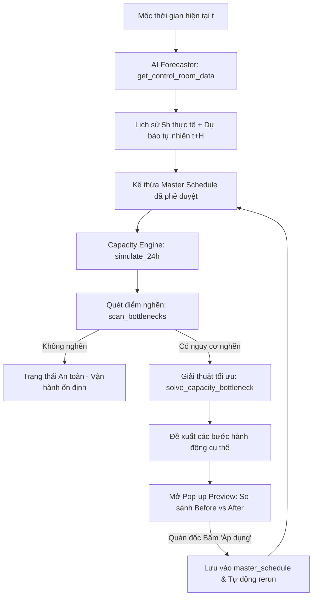

# 🏭 Control Room - Trung Tâm Điều Hành Logistics Thông Minh

Thư mục `control-room` chứa giao diện giám sát và điều độ vận hành thời gian thực (Executive Logistics Dashboard) cho hệ thống kho 3 tầng DENSO, được xây dựng trên nền tảng **Streamlit** kết hợp mô phỏng động học dòng chảy kho và trí tuệ nhân tạo.

---

## 📌 1. Tổng Quan Module

Control Room đóng vai trò là "bộ não điều hành" (Central Control Center), nơi quản đốc và nhân viên điều độ có thể:
1. **Giám sát trực quan trạng thái kho theo thời gian thực:** Nắm bắt khối lượng công việc (Workload Inbound/Outbound) và mức độ chiếm dụng kho (Inbound Dock, Kitting Buffer, Outbound Dock).
2. **Dự báo trước tương lai (Rolling Horizon Forecast):** Xem trước diễn biến tải và tồn kho trong 1h, 3h hoặc 12h tiếp theo nhờ AI mà không bị trễ pha.
3. **Phát hiện sớm điểm nghẽn (Early Bottleneck Detection):** Cảnh báo khi tồn kho chạm ngưỡng an toàn 80% (vạch vàng) hoặc vượt trần thiết kế (vạch đỏ).
4. **Đề xuất và xem trước kịch bản điều phối tự động:** Tự động đề xuất giải pháp san tải Heijunka, điều chuyển nhân sự, tăng ca OT, bổ sung xe tự hành AMR. Cho phép đối chiếu chi tiết **Trước vs Sau (Before vs After)** trước khi người dùng bấm nút áp dụng vào vận hành.

---

## 📂 2. Cấu Trúc File & Chức Năng

| Tên File | Vai trò & Chức năng chi tiết |
| :--- | :--- |
| `operation_dashboard.py` | Ứng dụng Streamlit chính của Control Room, tích hợp toàn bộ giao diện điều khiển, render bảng biểu, vẽ biểu đồ Matplotlib, quản lý bộ nhớ phiên (`st.session_state`) và kết nối với các AI Engine. |
| `README.md` | Tài liệu kỹ thuật hướng dẫn kiến trúc, chức năng và cách vận hành Control Room. |

---

## 🏗️ 3. Kiến Trúc & Luồng Vận Hành (Closed-Loop Rolling Control)

Hệ thống hoạt động theo vòng lặp đóng kiểm soát trượt (Closed-Loop Rolling Horizon), đảm bảo tính liên tục giữa quá khứ và tương lai:



---

## 🖥️ 4. Chi Tiết Giao Diện & 4 Hàng Chức Năng

### 🎛️ Sidebar (Thanh Điều Khiển Bên Trái)
- **Tùy chọn Theme:** Chuyển đổi linh hoạt giữa Giao diện Tối (**Dark Mode**) và Giao diện Sáng (**Light Mode**) với hệ thống màu và bảng biểu tương thích cao.
- **Khung thời gian dự báo (Horizon):**
  - `1h`: Phản ứng nhanh, sửa sai tức thời từng giờ.
  - `3h`: Lập kế hoạch ngắn hạn cho ca làm việc.
  - `12h`: Tầm nhìn chiến lược cho toàn bộ ca ngày/ca đêm.
- **Bộ chọn thời gian vận hành:** Cho phép chọn ngày và tua slider giờ trong tập dữ liệu thử nghiệm 2027.
- **Nút tua thời gian:**
  - `+1 Giờ`: Bước sang giờ tiếp theo, kế thừa tồn kho và số liệu thực thi của giờ trước.
  - `Làm mới (Reset)`: Đưa hệ thống về trạng thái ban đầu, xóa bỏ các điều độ tạm thời.

---

### 📊 Hàng 1: Thẻ Chỉ Số Trọng Yếu (KPI Metric Cards)
Hiển thị tức thời 5 chỉ số cốt lõi tại mốc thời gian hiện tại:
1. **Workload Inbound (pal/h):** Khối lượng hàng dỡ đến cảng.
2. **Workload Outbound (pal/h):** Nhu cầu đơn hàng xuất xưởng.
3. **Tồn kho Sàn Inbound:** Số pallet hiện tại / Sức chứa tối đa (200 pal) kèm % sức chứa.
4. **Tồn kho Kitting Buffer:** Số khay/thùng hiện tại / Sức chứa tối đa (500 khay) kèm % sức chứa.
5. **Tồn kho Sàn Outbound:** Số pallet hiện tại / Sức chứa tối đa (300 pal) kèm % sức chứa.

> Các thẻ tự động chuyển màu cảnh báo khi tồn kho chạm ngưỡng 80% cảnh báo sớm.

---

### 📈 Hàng 2: Dự Báo Workload & Kế Hoạch Điều Độ
- **Bảng 1 (Inbound) & Bảng 2 (Outbound):**
  - Cột *Mốc giờ*: Các khung giờ tương lai $t+1, \dots, t+H$.
  - Cột *Dự báo AI (pallets/h)*: Dự báo nhu cầu tự nhiên của mô hình AI Machine Learning.
  - Cột *Kế hoạch dỡ/xuất (pallets/h)*: Khối lượng công việc sau khi áp dụng điều phối san tải Heijunka.
  - Cột *Nhân công (người)* & *Số xe AMR*: Nguồn lực được bố trí.
  - Cột *Năng lực (pallets/h)*: Tính theo định mức DENSO (15 pal/người/h; 14 pal/xe/h).
  - Cột *Tải / Năng lực (%)*: Tỷ lệ tải để đánh giá quá tải hoặc nhàn rỗi.
- **Biểu đồ trực quan:**
  - Đường nét liền nối từ quá khứ 5h thực tế.
  - Đường nét đứt màu xanh thể hiện Dự báo AI.
  - Đường nét cam thể hiện Kế hoạch điều độ san tải sau tối ưu.

---

### 📦 Hàng 3: Mô Phỏng Tồn Kho 3 Tầng (3-Tier Storage Simulation)
Mô phỏng động học lượng tồn kho tại 3 khu vực:
- **Bảng 3:** Sàn Dỡ Hàng Inbound (Pallets).
- **Bảng 4:** Kho Đệm Kitting Buffer (Khay/Thùng).
- **Bảng 5:** Sàn Tập Kết Outbound (Pallets).
- Tích hợp 2 vạch chuẩn:
  - **Vạch vàng nét đứt (Cảnh báo 80%):** Inbound = 160 pal, Buffer = 400 khay, Outbound = 240 pal.
  - **Vạch đỏ nét liền (Trần sức chứa 100%):** Inbound = 200 pal, Buffer = 500 khay, Outbound = 300 pal.
- Cột đánh giá trạng thái tự động phân loại: `✓ An toàn`, `⚠ Cảnh báo`, `⛔ Quá tải`.

---

### 🚨 Hàng 4: Phân Tích Điểm Nghẽn & Đề Xuất Điều Độ Tự Động
- **Bảng danh sách điểm nghẽn:** Liệt kê mốc giờ, khu vực nghẽn và mức độ vượt ngưỡng (pallets/khay) tính chuẩn theo số nguyên.
- **Đề xuất phương án điều phối tự động:**
  - **Trạng thái & Cấp độ can thiệp:** `SUCCESS` (Triệt tiêu 100% điểm nghẽn) hoặc `MANUAL_REQUIRED` (Cần can thiệp cấp Quản đốc).
  - **Chi phí nhân công:** Tính toán chính xác số giờ-người (man-hours).
  - **Các bước hành động chi tiết:** Liệt kê rõ ràng từng hành động điều chuyển, OT, san tải Heijunka với số pallet/người/xe nguyên vẹn (ví dụ: *Đàm phán giao sớm 16 pallets từ 08:00 về 07:00*).
- **Nút "Mở chế độ Preview":** Kích hoạt cửa sổ Pop-up trực quan.

---

### 🔍 Pop-up Dialog: Xem Trước Phương Án Điều Chỉnh (Preview)
Cho phép quản đốc đánh giá toàn diện trước khi ra quyết định:
1. **Thẻ so sánh đỉnh tồn kho (Before vs After):** Đỉnh tồn Inbound, Buffer, Outbound kèm hiệu số vi sai $\Delta$ chặt chẽ (`After - Before`).
2. **3 Biểu đồ trực quan so sánh:** Đường xám nét đứt (Trước can thiệp) và đường màu nét liền (Sau can thiệp) đối chiếu với các ngưỡng cảnh báo.
3. **Bảng phân tích chi tiết từng giờ:** Hiển thị rõ Workload, Nhân sự, Tồn kho Trước $\rightarrow$ Sau và cột Ghi chú cải thiện (*Giảm tồn In ≈ 4 pal; Tăng tồn Buffer ≈ 12 khay*).
4. **Hai nút bấm quyết định:**
   - **`ÁP DỤNG PHƯƠNG ÁN ĐỀ XUẤT`**: Lưu toàn bộ lịch trình tối ưu vào `master_schedule`, kích hoạt cập nhật đồng bộ toàn bộ Dashboard.
   - **`TỪ CHỐI PHƯƠNG ÁN ĐỀ XUẤT`**: Đóng modal, giữ nguyên trạng thái hiện tại.

---

## ⚙️ 5. Quản Lý Trạng Thái Bền Vững (Session State)

Để tránh hiện tượng mất trạng thái khi Streamlit rerun, `operation_dashboard.py` thiết kế các biến trạng thái chuyên biệt:
- `st.session_state['master_schedule']`: Lưu trữ kế hoạch đã được quản đốc phê duyệt theo từng mốc thời gian $t$.
- `st.session_state['executed_history']`: Lưu vết lịch sử vận hành thực tế của các giờ đã trôi qua.
- `st.session_state['committed_heijunka_in']` & `st.session_state['committed_heijunka_out']`: Lưu lượng pallet đã dời ca để mô hình AI bóc tách sai số tự nhiên, ngăn ngừa hiện tượng thiên lệch phản hồi (**Feedback Confounding**).
- `st.session_state['simulated_stocks']`: Lưu tồn kho kết thúc của giờ $t$ để làm tồn kho đầu vào của giờ $t+1$.

---

## 🚀 6. Hướng Dẫn Khởi Chạy

### Yêu cầu tiên quyết:
- Đã cài đặt Python 3.10+
- Đã cài đặt các thư viện: `streamlit`, `pandas`, `numpy`, `matplotlib`, `joblib`, `scikit-learn`

### Lệnh khởi chạy:
Từ thư mục gốc của dự án:
```bash
streamlit run control-room/operation_dashboard.py
```

Dashboard sẽ tự động mở trên trình duyệt tại địa chỉ mặc định: `http://localhost:8501`.
