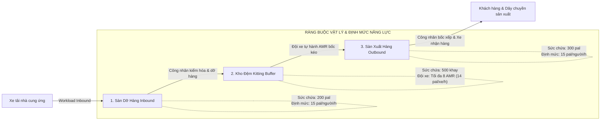

# 🏭 Factory Simulation - Mô Hình Số Hóa & Mô Phỏng Logistics Nhà Máy

Thư mục `factory-simulation` chứa tài liệu kiến trúc, đặc tả động học vật lý và quy chuẩn mô phỏng (Digital Twin & Discrete Event Simulation) cho hệ thống logistics nội bộ nhà máy DENSO.

---

## 📌 1. Bối Cảnh & Mô Hình Chuỗi Logistics 3 Tầng

Hệ thống kho thông minh DENSO được tổ chức theo cấu trúc 3 phân vùng vật lý kế tiếp nhau, vận hành theo triết lý **Kéo (Pull Flow)** của Hệ thống Sản xuất Toyota (Toyota Production System - TPS):



### Chi tiết 3 tầng kho:
1. **Tầng 1 - Sàn Dỡ Hàng Inbound (Inbound Dock):**
   - **Sức chứa thiết kế:** $200\text{ pallets}$. Ngưỡng cảnh báo $80\%$: $160\text{ pallets}$.
   - **Năng lực:** Nhân công dỡ hàng đạt định mức chuẩn DENSO: $15.0\text{ pallets/người/giờ}$.
   - **Hạn chế vật lý:** Mỗi giờ tối đa chỉ dỡ được $55\%$ lượng hàng tồn đọng trên dock do thời gian kiểm hóa và thủ tục quét mã vạch barcode.
2. **Tầng 2 - Kho Đệm Kitting Buffer:**
   - **Sức chứa thiết kế:** $500\text{ khay/thùng}$. Ngưỡng cảnh báo $80\%$: $400\text{ khay/thùng}$.
   - **Nhiệm vụ:** Phân tách kiện, lưu trữ đệm và cấp phát linh kiện theo quy chuẩn Kitting Box.
   - **Phương tiện chuyển tải:** Đội xe tự hành AMR (Autonomous Mobile Robots) quy mô tối đa 8 xe, định mức kéo hàng: $14.0\text{ pallets/xe/giờ}$.
3. **Tầng 3 - Sàn Tập Kết Xuất Hàng Outbound (Outbound Dock):**
   - **Sức chứa thiết kế:** $300\text{ pallets}$. Ngưỡng cảnh báo $80\%$: $240\text{ pallets}$.
   - **Năng lực:** Nhân công xếp xe đạt định mức $15.0\text{ pallets/người/giờ}$ theo lịch trình xuất hàng (Truck Dispatching Schedule).

---

## ⚙️ 2. Động Lực Học Chuỗi Cung Ứng (Discrete Event Pull Flow)

Mô hình mô phỏng được lập trình trong `data_generator_final.py` tại thư mục gốc, áp dụng các cơ chế kiểm soát động học chặt chẽ:

### A. Cơ chế Áp lực ngược (Backpressure Mechanism)
- **Chặn tràn Buffer:** Nếu kho đệm Buffer chạm mức tối đa ($s_{\text{buf}} \ge 500$), khâu Inbound lập tức bị phong tỏa, không được đẩy hàng vào tiếp cho dù nhân công Inbound đang nhàn rỗi.
- **Chặn tràn Outbound:** Nếu sàn Outbound chạm mức tối đa ($s_{\text{out}} \ge 300$), xe AMR tự động dừng kéo hàng ra từ Buffer để ngăn ngừa đổ tràn khu vực cửa xuất xưởng.

### B. Vòng Lặp Phản Hồi Tồn Kho ERP (ERP Closed-Loop Demand Feedback)
Nhu cầu đặt hàng đầu vào ($W_{\text{in}}$) không cố định mà tự động điều chỉnh theo độ lệch thâm hụt so với mức tồn kho mục tiêu (**Target Inventory Level**):
$$\text{Target Inventory} = 200 \times 0.4 + 500 \times 0.65 + 300 \times 0.4 = 525\text{ units}$$
$$\Delta_{\text{deficit}} = \text{Target Inventory} - (s_{\text{in}} + s_{\text{buf}} + s_{\text{out}})$$
$$W_{\text{in}} = \max\left(0, W_{\text{raw}} + 0.15 \cdot \Delta_{\text{deficit}}\right)$$
Điều này phản ánh chính xác nghiệp vụ quản trị kho ERP thực tế: khi kho cạn kiệt, hệ thống tự động tăng lượng đặt hàng bù đắp; khi kho đầy ứ, hệ thống tự động siết giảm lượng nhập.

### C. Cơ chế Giới hạn dồn ứ (Soft Cap)
Nhằm phản ánh giới hạn vật lý tối thượng của nhà máy, khi dồn ứ cục bộ xảy ra vượt quá $2.5$ lần sức chứa thiết kế, hàng hóa bị từ chối nhập viện để bảo đảm an toàn cháy nổ và lối thoát hiểm.

---

## ⚡ 3. 5 Kịch Bản Căng Thẳng Vận Hành (Stress-Test Scenarios 2027)

Tập dữ liệu năm 2027 được thiết kế đặc thù với 5 kịch bản biến động khắc nghiệt nhằm kiểm thử toàn diện khả năng thích ứng của AI và năng lực tự điều độ của Control Room:

| STT | Kịch Bản (Scenario) | Khoảng thời gian | Bản chất biến động & Thách thức vận hành |
| :---: | :--- | :--- | :--- |
| **1** | **Volume Spike (+60%)** | `05/01/2027 08:00` $\rightarrow$ `07/01/2027 18:00` | Nhu cầu cả Inbound và Outbound tăng vọt $60\%$. Dễ gây nghẽn vỡ sàn Inbound và Buffer nếu không đàm phán giao sớm Heijunka và tăng ca OT. |
| **2** | **Zone Imbalance (Dock Congestion)** | `18/01/2027 08:00` $\rightarrow$ `20/01/2027 18:00` | Mất cân đối nghiêm trọng: Inbound tăng $+70\%$ trong khi Outbound giảm $-40\%$. Cần kích hoạt Cross-dock điều chuyển nhân sự từ Outbound sang Inbound. |
| **3** | **Pre-Holiday Rush** | `01/02/2027 06:00` $\rightarrow$ `04/02/2027 22:00` | Đợt cao điểm dồn dập trước kỳ nghỉ Tết Nguyên Đán (Inbound $+45\%$, Outbound $+55\%$). |
| **4** | **Post-Holiday Recovery** | `15/02/2027 00:00` $\rightarrow$ `17/02/2027 23:00` | Đợt tái phục hồi sản xuất sau kỳ nghỉ lễ với lượng hàng tồn đọng lớn tích lũy đồng thời. |
| **5** | **AMR Breakdown** | `10/03/2027 08:00` $\rightarrow$ `11/03/2027 20:00` | Sự cố kỹ thuật: Đội xe AMR bị hỏng 6 xe, chỉ còn 2 xe hoạt động ($25\%$ công suất). Kho đệm Buffer bị ứ nghẽn nghiêm trọng không thể xả hàng ra sàn Outbound. |

---

## 📊 4. Cấu Trúc Bảng Dữ Liệu Mô Phỏng (`denso_logistics_simulation_test.csv`)

File dữ liệu gốc mô phỏng chuỗi thời gian liên tục 15 tháng ($10.944$ dòng, bước nhảy 1 giờ từ `2026-01-01 00:00` đến `2027-03-31 23:00`):

| Tên Cột | Kiểu Dữ Liệu | Đơn vị | Ý nghĩa nghiệp vụ |
| :--- | :---: | :---: | :--- |
| `timestamp` | `datetime` | `YYYY-MM-DD HH:MM` | Mốc thời gian từng giờ. |
| `workload_inbound` | `int` | pallets | Khối lượng hàng về cần dỡ tại dock nhập. |
| `workload_outbound` | `int` | pallets | Khối lượng đơn hàng cần xuất tại dock xuất. |
| `labor_inbound` | `int` | người | Số lượng công nhân được phân bổ ở khâu Inbound. |
| `labor_outbound` | `int` | người | Số lượng công nhân được phân bổ ở khâu Outbound. |
| `amr_active` | `int` | xe | Số lượng xe tự hành AMR đang hoạt động (tối đa 8 xe). |
| `storage_inbound` | `float` | pallets | Lượng hàng thực tế tồn đọng tại Sàn Dỡ Hàng Inbound. |
| `storage_buffer` | `float` | khay/thùng | Lượng hàng thực tế lưu trữ tại Kho Đệm Kitting Buffer. |
| `storage_outbound` | `float` | pallets | Lượng hàng thực tế tập kết tại Sàn Xuất Hàng Outbound. |
| `scenario` | `string` | text | Tên kịch bản vận hành (`Normal`, `Volume Spike`,...). |

---

## 🔄 5. Hướng Dẫn Tái Tạo & Mở Rộng Dữ Liệu Mô Phỏng

Để tái tạo lại toàn bộ tập dữ liệu hoặc thử nghiệm thay đổi các tham số vật lý (tỷ lệ dỡ hàng, định mức AMR, công suất kho):

1. Mở file [`data_generator_final.py`](file:///c:/Users/Admin/Desktop/denso/DENSO_Factory_Hackathons-D2-babi/data_generator_final.py).
2. Tùy chỉnh các hằng số ở đầu file:
   ```python
   MAX_STORAGE_INBOUND = 200
   MAX_STORAGE_BUFFER = 500
   MAX_STORAGE_OUTBOUND = 300
   RATE_LABOR_IN = 15.0
   RATE_AMR = 14.0
   ```
3. Chạy script để xuất lại file CSV chuẩn:
   ```bash
   python data_generator_final.py
   ```
