# 🧠 Prediction & Capacity Mode - AI Dự Báo & Tối Ưu Năng Lực Vận Hành

Thư mục `prediction-capacity-mode` chứa toàn bộ lõi thuật toán học máy (Machine Learning) và giải thuật tối ưu hóa điều độ vận hành (Capacity Optimization & Heijunka Dispatching) cho chuỗi logistics kho 3 tầng DENSO.

---

## 📌 1. Tổng Quan Kiến Trúc 2 Tầng (Two-Tier Architecture)

Module này được thiết kế theo mô hình 2 tầng liên kết chặt chẽ:

```mermaid
flowchart LR
    subgraph TẦNG 1: AI FORECASTING
        D[Tập dữ liệu 2026] --> M[Huấn luyện HistGradientBoosting]
        M --> ART[model_inbound.pkl / model_outbound.pkl]
        ART --> INF[Inference Engine: WarehouseForecaster]
        INF --> ADAPT[Online Adaptive Bias: Khử nhiễu & Sửa sai tức thời]
    end

    subgraph TẦNG 2: CAPACITY OPTIMIZATION
        ADAPT --> PLAN[Kế hoạch Workload Dự báo t+H]
        PLAN --> SIM[simulate_24h: Mô phỏng dòng chảy 3 tầng]
        SIM --> SCAN[scan_bottlenecks: Quét nguy cơ vượt ngưỡng 80%]
        SCAN --> SOLVE[solve_capacity_bottleneck: Giải thuật Heijunka & Điều phối]
        SOLVE --> OUT[Kế hoạch tối ưu & Hành động cụ thể]
    end
```



1. **Tầng 1 (AI Forecasting):** Dự báo khối lượng công việc Inbound và Outbound trong các khung thời gian linh hoạt (1h, 3h, 12h) với cơ chế tự học và bù sai số thích ứng thời gian thực.
2. **Tầng 2 (Capacity Engine):** Tiếp nhận dữ liệu dự báo, mô phỏng dòng chảy kho 3 tầng và tự động tìm kiếm giải pháp điều phối nguồn lực tối ưu nhằm triệt tiêu hoàn toàn các nguy cơ nghẽn kho.

---

## 📂 2. Cấu Trúc File & Chức Năng Chi Tiết

| File / Thư mục | Chức năng & Vai trò |
| :--- | :--- |
| `prediction_model_final.py` | Kịch bản huấn luyện 2 mô hình hồi quy `HistGradientBoostingRegressor` trên tập dữ liệu năm 2026. Xây dựng ma trận đặc trưng sâu (lags, rolling stats, spike ratio, shift pattern) và xuất các file mô hình `.pkl`. |
| `inference_final.py` | Lớp `WarehouseForecaster` phục vụ suy luận thời gian thực cho Control Room. Cung cấp cơ chế **Online Adaptive Bias** (EMA tức thời cho 1h, Window Mean cho 3h, Shift Bias cho 12h), tính dải an toàn Upper 90% và khử nhiễu can thiệp con người (*De-confounding Feedback*). |
| `capacity_model.py` | Lớp `CapacityModelEngine` mô phỏng vật lý dòng chảy kho 3 tầng (`simulate_24h`), hàm tính điểm phạt (`calculate_plan_penalty`), bộ quét điểm nghẽn (`scan_bottlenecks`) và giải thuật Heijunka cục bộ tìm kiếm các bước can thiệp tối ưu. |
| `app.py` | Ứng dụng Streamlit chuyên biệt để kiểm thử và phân tích độc lập các chức năng dự báo và điều độ. |
| `model_inbound.pkl` | Trọng số mô hình AI dự báo Workload Inbound đã huấn luyện. |
| `model_outbound.pkl` | Trọng số mô hình AI dự báo Workload Outbound đã huấn luyện. |
| `model_features.pkl` | Danh sách các cột đặc trưng đầu vào tương ứng cho từng mô hình. |
| `table_1_workload_inbound.csv` | Bảng dự báo & so sánh năng lực Inbound qua 2.160 mốc giờ kiểm thử 2027. |
| `table_2_workload_outbound.csv` | Bảng dự báo & so sánh năng lực Outbound qua 2.160 mốc giờ kiểm thử 2027. |
| `table_3_storage_inbound.csv` | Bảng mô phỏng tồn kho Sàn Dỡ Hàng Inbound và đánh giá điểm nghẽn. |
| `table_4_storage_buffer.csv` | Bảng mô phỏng tồn kho Kitting Buffer và đánh giá điểm nghẽn. |
| `table_5_storage_outbound.csv` | Bảng mô phỏng tồn kho Sàn Tập Kết Outbound và đánh giá điểm nghẽn. |
| `README.md` | Tài liệu kỹ thuật chi tiết của module. |

---

## 🔬 3. Tầng 1: Thuật Toán & Đặc Trưng Dự Báo AI

### Đặc Trưng Đầu Vào (Feature Engineering):
1. **Biến trễ theo giờ (Lag Features):** $t-1, t-2, t-3, t-4, t-12, t-18, t-24$ (chu kỳ ngày), $t-72$ (3 ngày), $t-168$ (1 tuần).
2. **Trung bình trượt (Rolling Means):** Cửa sổ 3h, 6h, 12h, 24h phản ánh xu hướng ngắn và trung hạn.
3. **Chỉ số xung nhịp (Spike & Acceleration):**
   - Tỷ lệ xung đột biến ngắn hạn: $\text{spike\_ratio} = \frac{y_{t-1} + 1}{y_{t-3} + 1}$.
   - Gia tốc biến thiên: $\text{diff} = y_{t-1} - y_{t-2}$.
   - Đỉnh trần 24h: $\text{rollmax\_24h} = \max(y_{t-1}, \dots, y_{t-24})$.
   - Tỷ lệ so với mức nền: $\frac{y_{t-1} + 1}{\text{rollmean\_6h} + 1}$.
4. **Đặc trưng lịch & Ca làm việc (Operational Shift Codes):**
   - `0`: Ca đêm (20:00 - 05:00) - Tải thấp.
   - `1`: Chuyển giao đầu ca sáng (06:00 - 07:00) - Bước nhảy tự nhiên.
   - `2`: Cao điểm sáng (08:00 - 10:00) - Tải cực đại.
   - `3`: Nghỉ trưa (11:00 - 12:00) - Tải giảm tạm thời.
   - `4`: Cao điểm chiều (14:00 - 16:00) - Tải cao.
   - `5`: Ca chiều bình thường (13:00, 17:00 - 19:00).

### Cơ Chế Sửa Sai Thích Ứng Thời Gian Thực (Online Adaptive Bias):
Khi nhà máy gặp các đợt biến động bất thường (như *Volume Spike +60%* hay *Dock Congestion*), mô hình tĩnh truyền thống thường bị trễ pha. Module áp dụng cơ chế thích ứng nhanh:
- **Khung 1h:** Áp dụng bộ lọc Single EMA:
  $$\text{Bias}_{1h}^{(t)} = 0.40 \cdot \text{Error}^{(t)} + 0.60 \cdot \text{Bias}_{1h}^{(t-1)}$$
- **Khung 3h:** Kết hợp EMA tức thời với hệ số suy giảm $\text{decay} = \max(0.4, 1.0 - \text{step} \cdot 0.05)$ để duy trì đà tăng trưởng của đợt spike.
- **Khung 12h:** Cập nhật Shift Bias theo từng loại ca làm việc:
  $$\text{ShiftBias}_{s}^{(t)} = 0.35 \cdot \text{Error}^{(t)} + 0.65 \cdot \text{ShiftBias}_{s}^{(t-1)}$$
- **Bóc tách can thiệp Heijunka (Zero Feedback Confounding):** Khi con người đã can thiệp dời hàng, lượng pallet can thiệp này được trừ ra trước khi tính sai số, giúp mô hình chỉ học bản chất quy luật tự nhiên, chống hiện tượng bùng nổ sai số ảo.

---

## ⚡ 4. Tầng 2: Mô Phỏng Dòng Chảy Kho & Thuật Toán Tối Ưu

### Định Mức Năng Lực & Ngưỡng An Toàn (DENSO Logistics Standards):
- **Năng lực bốc dỡ Inbound:** $15.0\text{ pallets/người/giờ}$.
- **Năng lực xuất hàng Outbound:** $15.0\text{ pallets/người/giờ}$.
- **Năng lực xe tự hành AMR:** $14.0\text{ pallets/xe/giờ}$ (chở hàng từ Buffer ra Outbound).
- **Trần sức chứa kho:**
  - Sàn Inbound Dock: $200\text{ pallets}$.
  - Kho Đệm Kitting Buffer: $500\text{ khay/thùng}$.
  - Sàn Outbound Dock: $300\text{ pallets}$.
- **Ngưỡng Vàng cảnh báo sớm (80%):** Inbound: $160\text{ pal}$; Buffer: $400\text{ khay}$; Outbound: $240\text{ pal}$.

---

### Hàm Mục Tiêu Chấm Điểm Phạt (Penalty Function):
Mỗi kịch bản điều phối được đánh giá qua hàm mục tiêu tổng thể:
$$\text{Total Penalty} = 10.0 \cdot \text{Penalty}_{\text{storage}} + 3.0 \cdot \text{Cost}_{\text{action}} + 1.0 \cdot \text{Score}_{\text{disruption}}$$

Trong đó:
- **$\text{Penalty}_{\text{storage}}$:**
  - Vượt ngưỡng cảnh báo vàng ($80\% \rightarrow 100\%$): Phạt trọng số $\times 1.0$.
  - Vượt trần đỏ ($> 100\%$): Phạt trọng số khắt khe $\times 5.0$ để tuyệt đối ngăn chặn vỡ trần kho.
- **$\text{Cost}_{\text{action}}$:** Chi phí làm thêm giờ OT ($1.5 \times \text{người} \times \text{giờ}$).
- **$\text{Score}_{\text{disruption}}$:** Mức độ xáo trộn do điều chuyển ngang nhân sự hoặc dời ca.

---

### 5 Chiến Lược Điều Phối Khắc Phục Điểm Nghẽn (Dispatching Heuristics):

1. **Micro-Heijunka Inbound (Kéo sớm đơn hàng):**
   - Đàm phán dời một lượng pallet nguyên ($15\%, 25\%, 35\%, 50\%$ làm tròn nguyên) về các ca trước đó $t-1, \dots, t-5$.
2. **Cross-dock Labor Dispatching (Điều chuyển ngang Outbound $\rightarrow$ Inbound):**
   - Điều động $1 \rightarrow 3$ công nhân từ khâu thấp điểm sang khâu quá tải mà không phát sinh chi phí OT.
3. **Shift Swap (Đổi ca dọc nội bộ):**
   - Huy động công nhân từ ca thấp điểm cùng ngày sang ca cao điểm.
4. **Overtime (Huy động làm thêm giờ OT):**
   - Bổ sung $1 \rightarrow 3$ công nhân làm OT $1 \rightarrow 2$ giờ tại các mốc xung tải cao.
5. **AMR Buffer Relief (Tăng cường xe tự hành AMR & Hỗ trợ Buffer):**
   - Kích hoạt thêm xe AMR dự phòng (tối đa 8 xe) và lên lịch sạc bù tại các ca thấp điểm để giải tỏa kho đệm.

---

## 🛠️ 5. Hướng Dẫn Huấn Luyện & Kiểm Thử

### Huấn luyện lại mô hình AI:
```bash
python prediction-capacity-mode/prediction_model_final.py
```
*Kết quả:* Mô hình sẽ đọc `denso_logistics_simulation_test.csv`, huấn luyện trên năm 2026 và ghi đè các file artifact `model_inbound.pkl`, `model_outbound.pkl`, `model_features.pkl`.

### Khởi chạy giao diện thử nghiệm độc lập:
```bash
streamlit run prediction-capacity-mode/app.py
```
